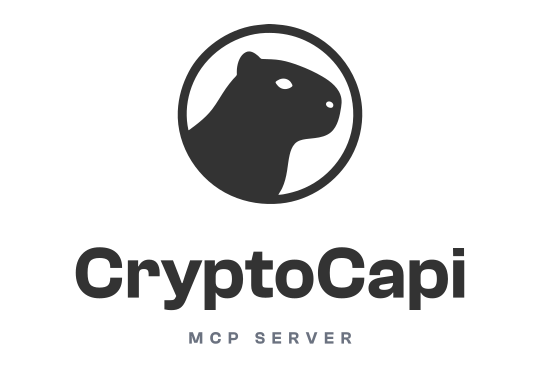

<p align="center">
  <a href="https://www.cryptocapi.com">
    <picture>
      <source media="(prefers-color-scheme: dark)" srcset=".github/assets/cryptocapi-logo-dark.svg">
      
    </picture>
  </a>
</p>

<p align="center">
  <b>Crypto market analysis with a verifiable seal</b>, as native tools for any agent that speaks MCP.<br>
  Every engine analysis ships with its SHA-256 seal, so you can <b>check it yourself</b>: you don't have to trust the model.
</p>

<p align="center">
  <a href="https://www.npmjs.com/package/@cryptocapi/mcp"></a>
  <a href="https://registry.modelcontextprotocol.io"></a>
  <a href="https://mcpservers.org/servers/jegoba90/cryptocapi-mcp"></a>
  <a href="https://github.com/Jegoba90/cryptocapi-mcp/actions/workflows/ci.yml"></a>
  <a href="https://github.com/Jegoba90/cryptocapi-mcp/actions/workflows/contrato.yml"></a>
  <a href="package.json"></a>
  <a href="LICENSE"></a>
</p>

<p align="center">
  <a href="https://glama.ai/mcp/servers/Jegoba90/cryptocapi-mcp"></a>
</p>

<p align="center">
  <a href="#paste-this-and-it-works">Get started</a>
  &nbsp;·&nbsp;
  <a href="#four-tools-three-engines-and-market-scan">Tools</a>
  &nbsp;·&nbsp;
  <a href="#try-it-without-signing-up">Demo</a>
  &nbsp;·&nbsp;
  <a href="#what-sets-it-apart">Verify the seal</a>
  &nbsp;·&nbsp;
  <a href="#configuration">Configuration</a>
  &nbsp;·&nbsp;
  <a href="https://www.cryptocapi.com">cryptocapi.com</a>
</p>

<br>

## Paste this and it works

No account, no sign-up, no key. It goes in your client's MCP configuration:

```json
{
  "mcpServers": {
    "cryptocapi": {
      "command": "npx",
      "args": ["-y", "@cryptocapi/mcp"]
    }
  }
}
```

That block is the format for Cursor (`.cursor/mcp.json` in the project, or
`~/.cursor/mcp.json` for all of them), Windsurf and Claude Desktop. Other
clients use a different shape:

**VS Code (GitHub Copilot).** The file is `.vscode/mcp.json`, the key is
`servers` rather than `mcpServers`, and each server carries `"type": "stdio"`.

```json
{
  "servers": {
    "cryptocapi": {
      "type": "stdio",
      "command": "npx",
      "args": ["-y", "@cryptocapi/mcp"]
    }
  }
}
```

**Claude Code and Codex.** One command, no file to edit. In Claude Code,
without `--scope user` it only applies to the project where you ran it.

```bash
claude mcp add --transport stdio cryptocapi -- npx -y @cryptocapi/mcp
codex mcp add cryptocapi -- npx -y @cryptocapi/mcp
```

**ChatGPT, no.** Its connectors only reach remote MCP servers, and this one
runs locally, over stdio.

With that you can already ask your agent about Bitcoin or Ethereum and get the
analysis signed by the two engines that sign it. How far the demo goes is
covered [below](#try-it-without-signing-up).

Using it with Claude for trading analysis? The guide
[Trading bot with Claude, without made-up prices](https://www.cryptocapi.com/guias/bot-de-trading-con-claude)
(in Spanish) has example prompts and the rules that keep the model from
inventing numbers.

## Four tools, three engines and Market Scan

| Tool | Engine | What it returns | What it requires |
|---|---|---|---|
| `get_insight` | **Radar** | Analysis of an asset. The `alpha` view carries the seal | `pulse` without a pass on a free key · `alpha` requires the **Radar Alpha** pass |
| `get_insight` with `engine="quant_plus"` | **Quant Plus** | The same asset signed by the deterministic engine, with a `reproducible` seal | **Quant Plus** pass |
| `batch_signals` | **Quant Plus** | Signals for several assets in one call | **Quant Plus** pass |
| `get_signal` | **Quant Pro** | Quantitative signal for a trading pair | **Quant Pro** pass |
| `scan_market` | **Market Scan** (ranking layer) | Market ranking by strategy | **Market Scan** pass |

There are five rows for four tools because **`get_insight` is the door to two engines**, and each one asks for its own pass. Having Radar Alpha does not open Quant Plus through that same tool: change the `engine` parameter and the required pass changes too.

**Market Scan is not a fourth engine.** It computes no signals of its own: it ranks the market on top of Quant Plus signals. It is sold separately because it is a different product.

<details>
<summary><b>What about <code>get_market_summary</code>, <code>get_prices</code> and <code>get_macro</code>?</b></summary>

<br>

**Until 2026-08-30 there were three more tools** (`get_market_summary`, `get_prices`, `get_macro`) that returned third-party data: market cap and fear and greed, CoinGecko prices and FRED macro series. They were retired because CryptoCapi is not an aggregator: its engines sign derived intelligence, and third-party data is an internal input. An agent asking "how is the market doing?" would grab the summary and leave with third-party data without touching an engine. Those endpoints still exist in the REST API; what was retired is the agent seeing them as tools.

</details>

**Each engine is bought separately, so having one does not unlock the others.** The descriptions name the engine that is needed, not a generic "PRO", so the agent doesn't waste attempts on tools its key can't open. When it tries anyway, the error tells it which pass is missing and which one it has, instead of a bare 403.

Watch out for a format detail that trips agents up: `get_signal` takes a **trading pair** (`BTCUSDT`) and `batch_signals` takes **coin identifiers** (`bitcoin`). Same engine, two formats, and each field spells it out in its schema.

## Try it without signing up

The default configuration uses the public demo key. No account needed.

```json
{
  "mcpServers": {
    "cryptocapi": {
      "command": "npx",
      "args": ["-y", "@cryptocapi/mcp"],
      "env": { "CRYPTOCAPI_API_KEY": "demo_btc_eth_public" }
    }
  }
}
```

The `env` is optional: **with no variable at all, the package falls back to the public demo key on its own**, so `command` and `args` are enough.

**What the demo key reaches, measured on 2026-08-30 against the published version:**

| Engine | Tool | With the demo key |
|---|---|---|
| Radar | `get_insight` | ✅ **bitcoin and ethereum only**, always in the `alpha` view with a seal, even if you ask for `pulse` |
| Quant Plus | `get_insight?engine=quant_plus` | ✅ **bitcoin and ethereum only**, reproducible seal with `input_vector` |
| Quant Plus | `batch_signals` | ✅ **bitcoin and ethereum only**, same reach as `get_insight` |
| Quant Pro | `get_signal` | ❌ closed, for any pair |
| Market Scan | `scan_market` | ❌ closed, for any strategy |

The closed ones **don't fail because of the coin, they always fail**: `get_signal` with `BTCUSDT`, Bitcoin's pair, also returns 403. The bitcoin-and-ethereum restriction applies to `get_insight` and `batch_signals`, nothing else.

So in a first session, `get_insight` and `batch_signals` answer, and they show the product: the signed analysis, on Bitcoin, from the two engines that sign it.

**To try all three engines and Market Scan with no coin limit** you need the free 14-day trial at https://www.cryptocapi.com. That key opens everything while it lasts.

## What sets it apart

The engines' response carries an `audit_trail` that includes a `protocol_hash`: a seal of the deterministic computation that produced the analysis. This package **forwards those values exactly as they came from the API, without re-serializing them**, because reformatting a single number would be enough for the hash to stop verifying.

You don't have to take our word for it: ask your agent for the analysis with `get_insight(coin_id="bitcoin", view="alpha")` and compare the `protocol_hash` in that output with the one from the same query made directly against the API.

```bash
curl -H "x-api-key: demo_btc_eth_public" \
  "https://api.cryptocapi.com/v1/market/insights/bitcoin?view=alpha"
```

They must be identical. If they ever aren't, it's a bug in this package and deserves an issue.

**The limit, stated as well:** the seal proves the computation is reproducible and that no language model wrote it. It does not prove the analysis is right, and today it is a checksum without a cryptographic signature, so it attests integrity, not origin.

### And the package can be verified too

The seal covers the data. That the tarball you download is the one built from this code is covered by something else: it is published **from CI with npm provenance**, so each version is tied to the commit and the workflow that built it.

```bash
npm audit signatures
```

The package's npm page also links to the exact commit. It is the same principle as the `protocol_hash`, applied to the supply chain instead of the data: you don't have to trust us, you can check.

## Configuration

| Variable | What for | Default |
|---|---|---|
| `CRYPTOCAPI_API_KEY` | Your API key | `demo_btc_eth_public` |
| `CRYPTOCAPI_API_BASE` | API base URL, for development | `https://api.cryptocapi.com/v1` |
| `CRYPTOCAPI_TIMEOUT_MS` | Time budget per request, in ms. See below | depends on the tool |

The variables go in the `env` of the configuration block, or with `--env` on
the command: in Claude Code, before `--transport` (if the server name lands
right after `--env`, it is taken as another variable); in Codex, after the
name.

**There isn't a single time budget.** Each tool asks for its own, because they
don't cost the same: 20 s for one engine on one asset (`get_insight`,
`get_signal`) and 45 s for the ones that go through several (`batch_signals`,
`scan_market`). Cutting a market sweep with the budget of a single read gives a
false timeout, and the agent concludes the API is down when it was actually
working.

`CRYPTOCAPI_TIMEOUT_MS` **replaces** those budgets, it does not add to them: the
number you set applies to all four tools. Setting it to `30000` to give
`scan_market` more room actually cuts it, from 45 s to 30. If you change it,
make it higher than the highest one.

When a tool times out, the error states the budget that actually applied, so
that is the number to beat.

Get a key with a 14-day trial: [cryptocapi.com](https://www.cryptocapi.com)

## Development

```bash
npm install
npm run check      # types + tests + dependency audit
npm run contrato   # checks against the live API that the copied contract still holds
```

The tests run on Node's native runner and **have no test dependency and never touch the network**: the API is faked with `node:http`. They test the package, not the service, which is what makes them fast and stable.

That runner loads TypeScript without transpiling, so **developing requires Node
22.18 or later**, even though the published package runs on 20: that is what
`engines` declares, and what CI checks by starting the built artifact on 20, 22
and 24. It is a development requirement, not a usage one.

That leaves out, on purpose, one half: whether the published package behaves well against the live API and inside an agent. That is what [PRUEBAS.md](PRUEBAS.md) (in Spanish) is for: fourteen manual checks run after every release.

`npm run contrato` covers part of that half with no human in the loop. The tests
stay off the network on purpose, and that isolation has a blind spot: in
September 2026 four bugs were found and **three were about what the API really
sends versus what the package assumed**, invisible to a fake server that only
returns what the test wrote. The contract check looks at exactly that, runs
once a day and opens an issue if something moved.

What has been found and not fixed yet lives in [PENDIENTES.md](PENDIENTES.md) (in Spanish), with the reason for each item and enough context to pick it up without re-investigating.

### Publishing

It is triggered by a tag and publishes from CI with provenance, to npm and to the MCP Registry:

```bash
npm version <patch|minor|major>   # also bump the two versions in server.json, and commit
git tag -a vX.Y.Z -m "vX.Y.Z" && git push origin vX.Y.Z
```

Then create the GitHub Release for that tag: Glama only picks up a new version from a Release, not from the tag. Creating it does not publish again, because `release.yml` runs on tag pushes only.

The workflow first checks that the tag matches the version in `package.json` and the two in `server.json`, because **an npm version cannot be reused** and that mistake can't be undone. Authentication is OIDC *trusted publishing*, with no token: it is bound to the name of `release.yml`, so renaming that file breaks publishing.

Once npm is up, a second job sends `server.json` to the Registry, also over OIDC. It runs separately so that, if the Registry fails, "Re-run failed jobs" retries only that, without going through `npm publish` again.

For the server, `npm version` is the single source of the version: it reads the published `package.json` to declare its `serverInfo.version`, and a handshake test fails if the two numbers drift apart. The only hand-written literal is the one in `server.json`, and if it falls behind, the tag doesn't pass the first check.

## Versioning

Since `1.0.0` the package follows [semver](https://semver.org/). The contract is the four tools, their parameters and the shape of their responses:

- **Patch (`1.0.x`):** fixes and text. Tools and their parameters stay the same.
- **Minor (`1.x.0`):** new things that break nothing, like one more tool or optional parameter.
- **Major (`2.0.0`):** removing or renaming a tool, or changing an existing parameter. If it is ever needed, it will be announced first.

Responses are passed through exactly as the API serves them, so a new field can show up in them without a new package version.

## License

[MIT](LICENSE)

<br>

<p align="center">
  <a href="https://www.cryptocapi.com"><b>cryptocapi.com</b></a>
  &nbsp;·&nbsp;
  <a href="https://www.npmjs.com/package/@cryptocapi/mcp">npm</a>
  &nbsp;·&nbsp;
  <a href="https://github.com/Jegoba90/cryptocapi-mcp/issues">Issues</a>
</p>
